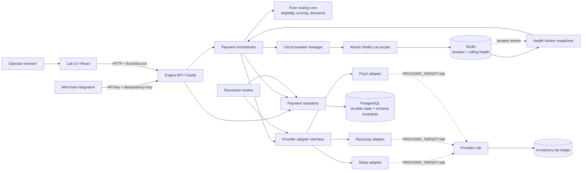
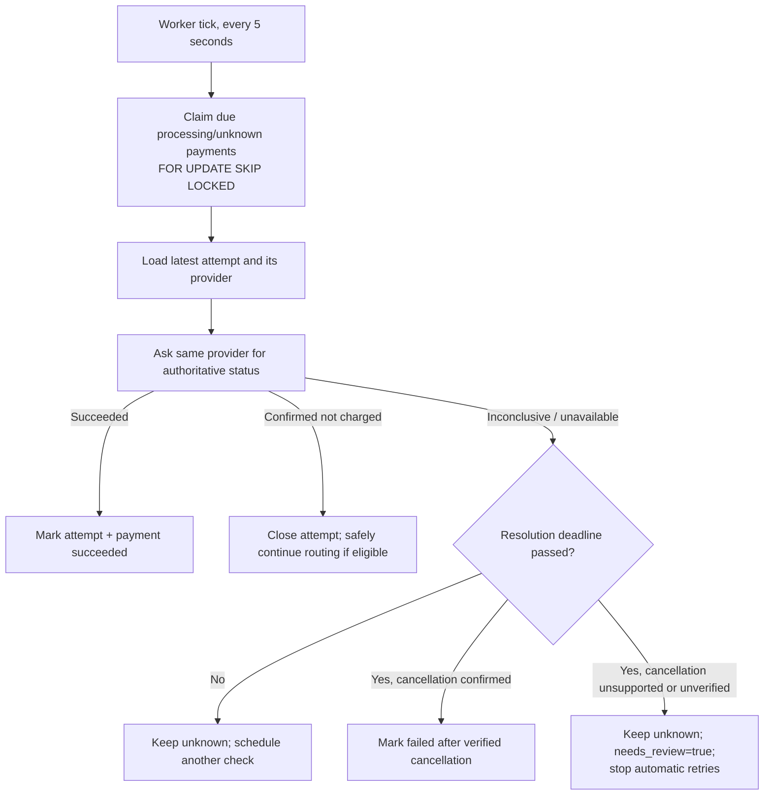
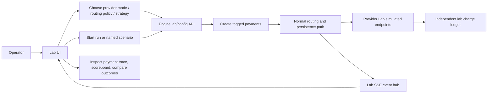
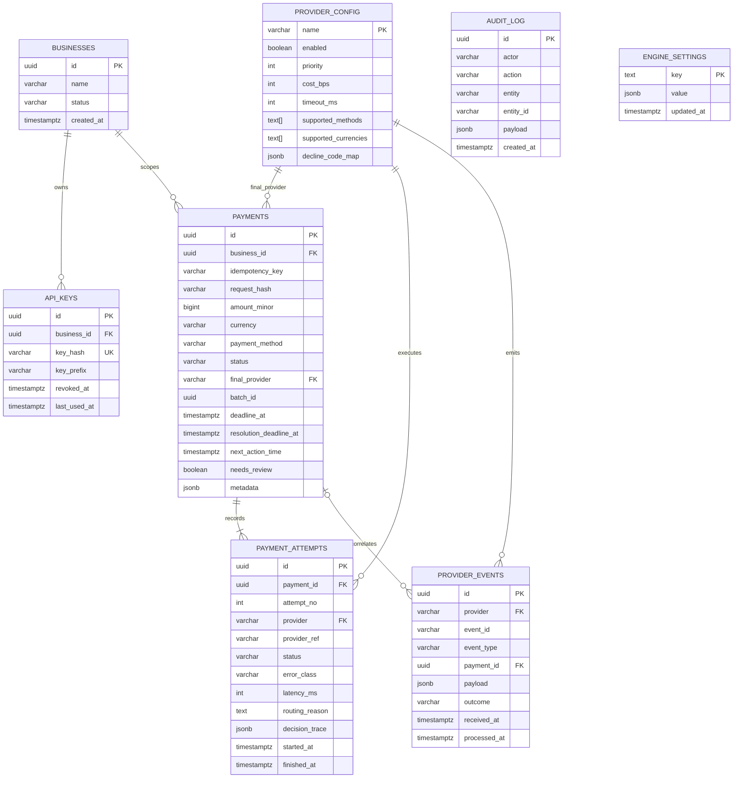

# PayRoute

PayRoute is a multi-tenant payment orchestration engine. It accepts idempotent payment requests, selects an eligible provider, records every provider attempt, and resolves ambiguous outcomes without blindly risking a second charge. The repository also includes a controlled provider simulator and an operator lab UI for exploring routing and failure behavior.

> **Status:** This repository is a development and demonstration system. Review deployment, security, compliance, and real-provider configuration before processing production payments.

## Contents

- [System at a glance](#system-at-a-glance)
- [Architecture](#architecture)
- [Payment and resolution flows](#payment-and-resolution-flows)
- [Data model](#data-model)
- [Schema design and invariants](#schema-design-and-invariants)
- [Repository layout](#repository-layout)
- [Run locally](#run-locally)
- [HTTP interfaces](#http-interfaces)
- [Routing and resilience](#routing-and-resilience)

## System at a glance

| Component | Responsibility | Main technology |
| --- | --- | --- |
| Engine API | Tenant-authenticated payment, status, configuration, and lab endpoints | Fastify, TypeScript |
| Orchestrator | Candidate selection, provider calls, retries/failover, state transitions | `packages/core`, `packages/providers` |
| Resolution worker | Reconcile due or unknown outcomes and safely resume work | In-process worker loop, PostgreSQL row locks |
| PostgreSQL | Durable payment state, idempotency, attempts, provider configuration, audit/event records | PostgreSQL 16 |
| Redis | Distributed circuit-breaker state, rolling health, events, cached snapshots | Redis 7, Lua |
| Provider adapters | Normalize provider-specific requests and outcomes | Stripe, Razorpay, PayU adapters |
| Provider Lab | Deterministic provider simulator with controllable fault modes and independent charge ledger | Fastify |
| Lab UI | Lab control, payment traces, strategy comparison, live updates | React, Vite, TypeScript |

## Architecture



### Runtime boundaries

- `packages/core` contains deterministic routing, classification, scoring, backoff, and transition logic. It is designed to be independent of database, network, clock, and random I/O.
- The engine owns HTTP/API concerns, persistence, provider invocation, and recovery. Provider calls occur outside short database transactions.
- PostgreSQL is the durable source of truth for payment idempotency and history. Redis coordinates shared, fast-changing provider health; it is not the payment ledger.
- The Provider Lab is a separate process and maintains its own in-memory ledger. It simulates provider behavior; it does not write the engine's database.
- The UI talks to the engine API. Its live lab stream uses server-sent events; database records remain the durable history.

## Payment and resolution flows

### Synchronous create and route

```mermaid
sequenceDiagram
  autonumber
  participant M as Merchant
  participant A as Engine API
  participant DB as PostgreSQL
  participant O as Orchestrator + core
  participant R as Redis health/breaker
  participant P as Provider adapter

  M->>A: POST /payments + Idempotency-Key
  A->>A: Authenticate tenant, validate request, hash canonical payload
  A->>DB: Insert payment (unique tenant + key)
  alt Existing key, same request hash
    DB-->>A: Existing payment (replay)
    A-->>M: Original payment result
  else Existing key, different request hash
    DB-->>A: Hash mismatch
    A-->>M: 422 idempotency conflict
  else New payment
    DB-->>A: Created payment
    A->>O: Orchestrate payment
    O->>R: Read provider health / breaker state
    O->>O: Filter, score, select provider; record decision trace
    O->>DB: Persist attempt before external call
    O->>P: Submit with stable attempt reference
    alt Definitive success or failure
      P-->>O: Normalized outcome
      O->>DB: Persist attempt outcome and payment transition
      O-->>A: Final/current payment
      A-->>M: 200 result
    else Ambiguous response
      P-->>O: Timeout / lost or inconclusive response
      O->>P: Query status on the same provider
      alt Provider confirms success
        P-->>O: Succeeded
        O->>DB: Mark attempt and payment succeeded
        O-->>A: Succeeded
        A-->>M: 200 result
      else Still unresolved
        O->>DB: Mark unknown and schedule resolution
        O-->>A: Unknown / processing
        A-->>M: 202 Accepted
      end
    end
  end
```

### Background recovery



An ambiguous timeout is not treated as proof that a payment failed. The engine checks the same provider first; it only fails over after authoritative confirmation that no charge was created. If the resolution deadline expires without verified cancellation, the payment stays `unknown` and is flagged for review.

### Operator lab flow



The UI has **Lab**, **Trace**, and **Compare** views. It loads provider health, settings, scoreboard, and recent payments through the engine API, then refreshes relevant views on payment, breaker, scoreboard, and scenario events.

## Data model



`AUDIT_LOG` and `ENGINE_SETTINGS` are standalone tables without entity foreign keys. `batch_id` groups lab traffic and is not a foreign key. Provider events may be correlated to a payment when known; uniqueness is enforced on `(provider, event_id)`.

## Schema design and invariants

The authoritative definitions are the forward-only migrations in [`migrations/`](migrations/).

| Area | Design | Enforced by |
| --- | --- | --- |
| Tenant isolation | Payments and API keys are scoped to `business_id`; key hashes are unique, raw keys are not persisted | Foreign keys; unique API key hash; API auth lookup |
| Request idempotency | One payment per `(business_id, idempotency_key)`; canonical request hash detects mismatched reuse | PostgreSQL unique constraint plus repository insert-on-conflict; HTTP 422 on payload mismatch |
| Money | Positive integer minor units (`BIGINT`); uppercase three-letter currency code | SQL checks and integer-based money helpers |
| Attempt history | Attempt number unique per payment; attempts cannot be deleted, terminal outcomes cannot be rewritten | Unique constraint and immutability trigger |
| At most one successful charge | Only one attempt may have `status='succeeded'` per payment | Partial unique index |
| Provider reference | Non-null provider references are unique within a provider | Partial unique index `(provider, provider_ref)` |
| Provider events | Duplicate provider webhook/event IDs are rejected | Unique `(provider, event_id)` |
| Audit history | Audit rows cannot be updated, deleted, or truncated | Database triggers |
| Scheduling | Nonterminal payments due for work can be found efficiently | Partial `next_action_time` index; worker locks rows with `SKIP LOCKED` |
| Routing explainability | Chosen attempt records a human-readable reason and structured decision trace | Immutable attempt metadata after insert |
| Configuration | Provider operational settings and engine overrides are database-backed; credentials come from environment | `provider_config`, `engine_settings`, startup configuration |

### Main state fields

- Payment statuses: `created`, `processing`, `requires_action`, `succeeded`, `failed`, `unknown`.
- Attempt statuses in SQL: `started`, `requires_action`, `succeeded`, `failed`, `unknown`.
- Canonical attempt error classes: `success`, `hard_decline`, `soft_decline`, `not_sent`, `rate_limited`, `config_error`, `bad_request`, `transient`, `ambiguous`, `action_required`.
- `unknown` is an intentional safety state: it means the charge outcome is not yet authoritative, not that it failed.

## Repository layout

```text
apps/
  engine/          Fastify API, orchestration, persistence, health/breakers, resolver
  provider-lab/    Controllable Stripe/Razorpay/PayU simulator and lab ledger
  lab-ui/          Operator console: Lab, Trace, Compare
packages/
  core/            Pure routing, scoring, classification, backoff, transitions
  providers/       Provider adapter interface and concrete adapters
  shared/          Shared types, money, hashing, payment state machine
migrations/        PostgreSQL schema migrations
benchmarks/        Throughput, idempotency, breaker, and telemetry scenarios
DECISIONS.md       Architecture decision records (design rationale and trade-offs)
docker-compose.yml Local PostgreSQL and Redis
```

## Run locally

### Prerequisites

- Node.js compatible with the workspace packages
- pnpm
- Docker with Docker Compose

### Start dependencies and applications

```bash
pnpm install
Copy-Item .env.example .env
pnpm db:up
```

The example environment defaults to PostgreSQL at `localhost:5433` and Redis at `localhost:6380`. Set an engine API key in `.env` before starting the engine:

```dotenv
ENGINE_API_KEY=local-development-key
PROVIDER_TARGET=lab
PROVIDER_LAB_URL=http://127.0.0.1:4000
```

In separate terminals:

```bash
pnpm dev:provider-lab
pnpm dev:engine
pnpm dev:lab-ui
```

Defaults: engine `http://localhost:3000`, Provider Lab `http://localhost:4000`, UI Vite development server (usually `http://localhost:5173`). Engine startup applies pending SQL migrations. The lab UI uses the engine API; configure its Vite proxy/API base if your local setup uses a different engine address.

Useful commands:

```bash
pnpm build
pnpm test
pnpm lint
pnpm benchmark
pnpm db:logs
pnpm db:down
```

## HTTP interfaces

The engine exposes these principal routes (all are mounted by the engine app):

| Route | Purpose |
| --- | --- |
| `GET /`, `GET /health`, `GET /live`, `GET /ready` | Liveness and readiness checks |
| `POST /payments` | Create or replay an idempotent payment; requires an `Idempotency-Key` and tenant API authentication |
| `GET /payments/:id`, `GET /payments` | Read payment detail/history and list payments |
| `GET /providers`, `GET /config`, `GET /settings` | Inspect provider health/configuration and engine settings |
| `POST /chat` | Lab assistant endpoint |
| `GET /lab/stream` | Server-sent events for lab activity |
| `POST /lab/providers/:name/mode` | Set provider simulation mode |
| `POST /lab/runs`, `GET /lab/runs/:batch_id` | Launch and inspect a batch run |
| `POST /lab/scenarios/:name/run`, `GET /lab/scenarios/:name/results` | Run and inspect named scenarios |

Exact request/response validation and authentication behavior are implemented in `apps/engine/src/api`. Do not place real card data in the lab metadata or logs.

## Routing and resilience

1. The engine validates payment input and authenticates the tenant. Money is carried as integer minor units.
2. PostgreSQL atomically creates or retrieves the tenant-scoped idempotent payment. A request hash mismatch for a reused key is rejected.
3. The orchestrator filters providers by enablement, method, currency, breaker state, attempt caps, and request deadline. The pure core scores eligible candidates according to configured strategy and creates an auditable decision trace.
4. A new attempt is persisted before provider I/O. Adapters map the stable attempt reference to provider-native idempotency behavior and normalize outcomes.
5. Redis Lua scripts atomically track rolling provider/method health, circuit state, and half-open probes. Local health snapshots keep the routing read path fast; breaker events update engine instances.
6. Known transient outcomes may retry according to backoff/deadline policy. Safe, definitive failures may fail over. Ambiguous outcomes are status-checked on the same provider, then resolved asynchronously if necessary.
7. The resolution worker runs every five seconds by default, claims due records with `FOR UPDATE SKIP LOCKED`, and never marks an unverified potentially charged payment failed when its resolution deadline expires.

For the rationale behind these choices, see [DECISIONS.md](DECISIONS.md).
